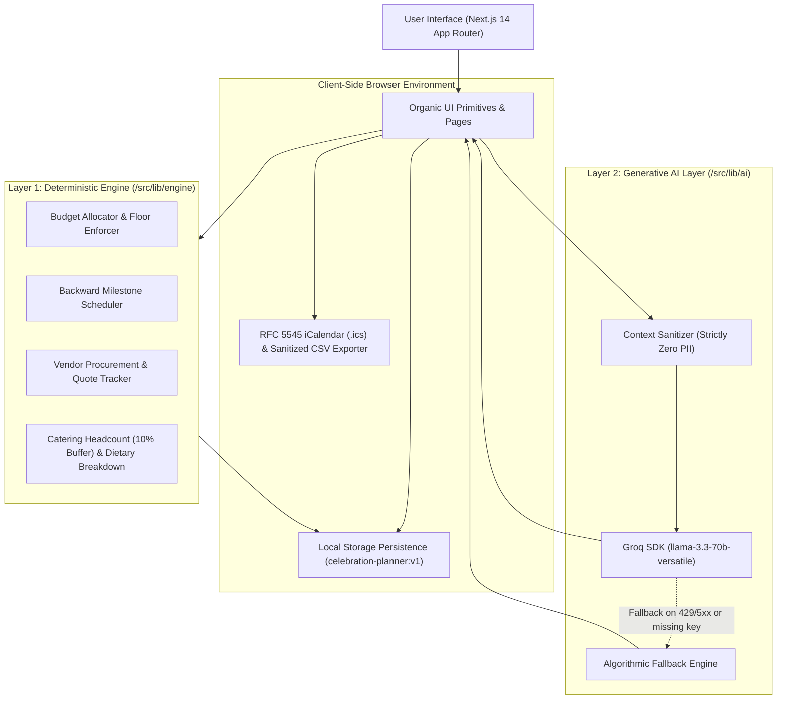

# Celebration & Event Planner

An editorial-grade celebration coordination platform and deterministic financial decision engine built with Next.js 14, TypeScript, and the Organic Design System.

The platform provides comprehensive event planning across weddings, milestone birthdays, and community festivals. It couples pure mathematical allocation algorithms with optional, privacy-isolated generative AI guidance to produce audit-ready budgets, backward-scheduled milestone timelines, vendor procurement trackers, catering headcount formulas, and printable broadsheet summaries.

**Live Production Deployment**: [https://celebration-planner-beta.vercel.app](https://celebration-planner-beta.vercel.app)

---

## Table of Contents

- [Architectural Philosophy](#architectural-philosophy)
- [Two-Layer Architecture](#two-layer-architecture)
- [Deterministic Calculation Engines](#deterministic-calculation-engines)
  - [Budget Allocation and Rebalancing Engine](#budget-allocation-and-rebalancing-engine)
  - [Backward Milestone Scheduling Engine](#backward-milestone-scheduling-engine)
  - [Vendor Procurement and Quote Comparison Engine](#vendor-procurement-and-quote-comparison-engine)
  - [Guest Headcount and Catering Buffer Engine](#guest-headcount-and-catering-buffer-engine)
  - [Client-Side Data Exporters](#client-side-data-exporters)
- [Generative AI Layer and Privacy Boundary](#generative-ai-layer-and-privacy-boundary)
  - [Model Specification](#model-specification)
  - [Context Sanitization Contract (Zero PII)](#context-sanitization-contract-zero-pii)
  - [Structured Validation and Error Fallbacks](#structured-validation-and-error-fallbacks)
- [Application Route Map](#application-route-map)
- [Organic Design System](#organic-design-system)
  - [Design Tokens](#design-tokens)
  - [Typography Hierarchy](#typography-hierarchy)
  - [Asymmetrical Border Radii](#asymmetrical-border-radii)
  - [Accessibility and Reduced Motion](#accessibility-and-reduced-motion)
- [Data Models and Schemas](#data-models-and-schemas)
- [Security and Threat Model](#security-and-threat-model)
- [Directory Structure](#directory-structure)
- [Test Suite and Verification Matrix](#test-suite-and-verification-matrix)
- [Operational Runbook](#operational-runbook)
- [Free Deployment Guide](#free-deployment-guide)
  - [Deploying on Vercel (Recommended)](#deploying-on-vercel-recommended)
  - [Deploying on Netlify](#deploying-on-netlify)
  - [Environment Variables on Production](#environment-variables-on-production)
- [Limitations and Disclaimers](#limitations-and-disclaimers)
- [License](#license)

---

## Architectural Philosophy

Most consumer event planning tools conflate mathematical reality with generative suggestion, resulting in inaccurate budget projections, fragile timelines, and unnecessary exposure of personal attendee data to third-party language models.

Celebration & Event Planner enforces a strict architectural boundary:
1. **Mathematical Certainty First**: All financial targets, payment schedules, lead-time deadlines, catering counts, and vendor comparisons are calculated through pure, deterministic TypeScript functions that execute entirely within the client browser.
2. **Generative Assistance Second**: Generative artificial intelligence is treated strictly as an ephemeral creative assistant for thematic ideation and logistical brainstorming. It never sets budgets, modifies timelines, or stores data.
3. **Local-First Privacy**: User data (guest identities, personal contacts, financial records, contractual notes) is stored in the browser's `localStorage` and never transmitted across the network except in strictly sanitized aggregate form when explicitly calling the AI assistant.

---

## Two-Layer Architecture



---

## Deterministic Calculation Engines

The deterministic engine (`/src/lib/engine`) is written in pure TypeScript with zero runtime external dependencies and 100% automated test coverage.

### Budget Allocation and Rebalancing Engine

The budget engine (`/src/lib/engine/budget.ts`) calculates itemized expense categories based on event typology, city tier, venue environment, and user priority preferences.

#### 1. Base Allocation Percentages

Base allocations represent industry-standard expense distributions summing to exactly 100%:

| Category | Wedding | Birthday | Community Festival |
|---|---|---|---|
| Venue | 25% | 20% | 20% |
| Catering | 30% | 35% | 30% |
| Decor / Staging | 10% | 12% | 12% (Sound & Lighting) |
| Photography | 10% | 4% | - |
| Attire | 8% | - | - |
| Entertainment | 6% | 15% | 10% |
| Invitations | 3% | - | - |
| Transport | 3% | - | - |
| Cake | - | 6% | - |
| Return Gifts / Favors | - | 4% | - |
| Permits & Safety | - | - | 8% |
| Promotion | - | - | 10% |
| Event Supplies | - | - | 5% |
| Contingency Reserve | 5% | 4% | 5% |

#### 2. Priority Redistribution Algorithm

When a user selects up to 3 priority focus areas (e.g., Food & Beverage, Venue, Decor, Photography, Entertainment, Guest Comfort), each selected priority receives a `+3%` allocation boost (`PRIORITY_BOOST_POINTS = 3`).

To preserve a total of 100%, the boosted percentage is deducted proportionally from all non-boosted categories:

$$\Delta_{\text{donor}} = \text{PRIORITY\_BOOST\_POINTS} \times \frac{\text{pool}_{\text{donor}}}{\sum \text{pool}_{\text{all donors}}}$$

Where:
- For standard categories: $\text{pool}_c = \text{alloc}_c$
- For contingency reserve: $\text{pool}_{\text{contingency}} = \max(0, \text{alloc}_{\text{contingency}} - 4\%)$
- The non-negotiable contingency floor is strictly maintained at $\ge 4\%$.

#### 3. Venue and Environmental Adjustments

- **Outdoor Venues**: Adds `+2%` to production (`decor` or `sound-and-lighting`) for weather resilience and structures, and `+1%` to contingency reserve (`OUTDOOR_CONTINGENCY_POINTS = 1`).
- **Hybrid Venues**: Adds `+1%` to contingency reserve for dual-setup transition risk (`HYBRID_CONTINGENCY_POINTS = 1`).

#### 4. City Tier Shifts

- **Tier 1 Metro**: Adjusts `+3%` toward venue rental rates and `-3%` from catering (`METRO_VENUE_SHIFT = 3`).
- **Tier 3 Town**: Adjusts `-3%` from venue rental and `+3%` toward catering and guest hospitality (`TOWN_VENUE_SHIFT = -3`).

#### 5. Catering Viability Floors

The engine enforces mandatory minimum per-guest catering floors:
- **Wedding**: ₹600 per guest
- **Birthday**: ₹400 per guest
- **Community**: ₹250 per guest

If the calculated per-guest catering cost is below the floor:

$$\text{per\_guest} = \frac{\text{alloc}_{\text{catering}} \times \text{totalBudget}}{\text{guestCount}} < \text{floor}$$

The engine automatically reallocates discretionary funds from `decor` and `entertainment` to bring catering up to the minimum viable floor, surfacing a descriptive notice to the user.

#### 6. Whole Currency Rounding

Planned amounts are rounded to whole currency units. The difference caused by rounding sums is reconciled by adjusting the single largest category line, guaranteeing:

$$\sum_{i=1}^{n} \text{plannedAmount}_i = \text{totalBudget}$$

#### 7. Over-Budget Detection

When actual expenses are logged, lines are evaluated against an over-budget ratio threshold:

$$\frac{\text{actualAmount}}{\text{plannedAmount}} \ge 1.10$$

Lines exceeding planned targets by 10% or more trigger high-contrast warning badges.

#### 8. Dynamic Rebalancing

When a user modifies a planned line item in the Budget Ledger, the `rebalance()` function recalculates the ledger:
- Upward adjustments absorb funds from contingency down to the 4% minimum floor.
- Any remaining deficit is drawn proportionally from the largest non-contingency category.
- Negative values or adjustments that violate the 4% contingency floor are rejected with descriptive validation errors.

---

### Backward Milestone Scheduling Engine

The timeline engine (`/src/lib/engine/timeline.ts`) constructs an action roadmap anchored to the celebration date ($T_0$).

#### Lead-Time Offset Logic

Each event type uses a curated set of milestone templates with defined ideal lead-time days:

$$\text{idealDueDate} = T_0 - (\text{leadTimeDays} \times 86,400,000\text{ ms})$$

Conditional milestones are dynamically added based on brief metadata:
- **Outdoor Venues**: "Arrange weather backup / tent" ($T - 30$ days, critical, minimum 7 days).
- **Dietary Requirements**: "Plan separate dietary menu" ($T - 21$ days, critical, minimum 7 days).
- **Large Community (>200 guests)**: "Arrange crowd management and first-aid" ($T - 20$ days, critical, minimum 7 days).
- **High Attendance (>150 guests)**: "Arrange parking or transport" ($T - 25$ days, normal, minimum 7 days).

#### Short-Notice Schedule Compression

When an event is planned on short notice (e.g., date is fewer than 30 or 60 days away), ideal due dates may fall before today's date ($T_{\text{due}} < T_{\text{today}}$).

Rather than dumping all overdue tasks onto day zero, the engine executes sequential schedule staggering:
1. Critical overdue tasks are scheduled consecutively starting at $T_{\text{today}} + 0, + 1, + 2, \dots$ days.
2. Non-critical overdue tasks are staggered subsequently.
3. Every overdue task is capped so it never exceeds the celebration date ($T_0$).
4. If remaining days to the event are less than a task's `minimumLeadDays`, the task is marked as `atRisk = true` with an explanatory diagnostic notice.

#### Feasibility Scoring

The engine evaluates timeline feasibility into three tiers:
- **Very Tight**: $\ge 3$ tasks at risk or $\le 14$ days remaining.
- **Tight**: $\ge 1$ task at risk, $\ge 2$ tasks compressed, or $\le 90$ days remaining.
- **Comfortable**: All milestones can be completed within standard lead times.

---

### Vendor Procurement and Quote Comparison Engine

The vendor engine (`/src/lib/engine/vendors.ts`) orchestrates procurement workflows across service providers.

#### 1. Dynamic Checklist Generation

Generates a foundational procurement roster tailored to the event type, augmented by operational conditions:
- **Outdoor Venues**: Ingests Weatherproof Tent & Canopy Rental and Heavy-Duty Power Generator Rental with vendor interview question sets.
- **Attendance > 300**: Adds Additional Catering Staff and Crowd Barriers & Security Marshals.
- **Hybrid Setups**: Adds Indoor & Outdoor Contingency Logistics.
- **Photography Priority**: Ingests Second Shooter & Drone Cinematographer.
- **Dietary Needs**: Ingests Specialty Caterer & Allergen Consultant.

#### 2. Quote-to-Budget Comparison Math

When a quote is received, `compareQuote()` correlates the vendor category to the planned budget line:

$$\text{difference} = \text{quoteAmount} - \text{plannedAmount}$$

$$\text{percentage} = \left| \frac{\text{difference}}{\text{plannedAmount}} \right| \times 100$$

The result is classified as:
- `isAbove`: Quote exceeds planned budget line.
- `isBelow`: Quote is under planned budget line.
- `isEqual`: Quote exactly matches planned budget.

The user can synchronize the accepted quote directly into the actual budget line with a single action.

#### 3. Next to Book Algorithmic Heuristic

To eliminate decision fatigue, `getNextToBookCategory()` identifies the single most urgent unbooked vendor category by:
1. Finding all uncompleted critical milestones in the timeline.
2. Sorting them by `dueDate` ascending.
3. Matching task categories and title keywords against vendor categories.
4. Flagging the matched vendor category with a high-visibility "Next to book" badge.

---

### Guest Headcount and Catering Buffer Engine

The guest engine (`/src/lib/engine/guests.ts`) manages attendee rosters and catering forecasts.

#### 1. Catering Headcount Formula

Standard catering agreements require a safety margin for unexpected attendees and appetite variance:

$$\text{confirmedHeadcount} = \sum_{g \in \text{RSVP}_{\text{yes}}} (1 + \text{plusOnes}_g)$$

$$\text{suggestedCatering} = \lceil \text{confirmedHeadcount} \times 1.10 \rceil$$

A 10% buffer is applied and rounded up to the nearest integer.

#### 2. RSVP Accounting

Tracks four distinct metric buckets:
- `totalInvited`: Total invitations issued.
- `totalInvitedHeadcount`: Maximum possible attendance including all offered plus-ones.
- `confirmedHeadcount`: Definite seats required ($\text{RSVP} = \text{yes}$).
- `declinedCount`: Number of invitations declined.
- `pendingHeadcount`: Outstanding seats awaiting response.

#### 3. Dietary Aggregation

Parses guest dietary selections, grouping them into structured categories (Vegetarian, Vegan, Jain, Halal, Gluten-Free, Nut Allergy) to provide exact counts for culinary contractors.

---

### Client-Side Data Exporters

Data exports are generated client-side with zero external services.

#### 1. RFC 5545 iCalendar (`.ics`) Generator

The calendar generator (`/src/lib/engine/ics.ts`):
- Converts the celebration event into an all-day `VEVENT` with alarms.
- Converts critical timeline tasks into actionable `VTODO` entries with explicit `DUE`, `SUMMARY`, and `PRIORITY` fields.
- Sanitizes text to escape semicolons, commas, and newlines per RFC 5545 specifications.

#### 2. Formula-Injection-Sanitized CSV Exporter

To protect users opening exported attendee rosters in Microsoft Excel, Google Sheets, or LibreOffice Calc, all cell values are sanitized against CSV Formula Injection (CWE-1236):

If a cell string begins with `=`, `+`, `-`, or `@`, it is automatically prefixed with a single quotation mark (`'`), ensuring spreadsheets treat the cell strictly as literal text.

---

## Generative AI Layer and Privacy Boundary

The generative AI layer (`/src/lib/ai`) provides contextual ideation and conversational planning assistance.

### Model Specification

- **Provider**: Groq Cloud SDK
- **Model**: `llama-3.3-70b-versatile`
- **Temperature**: `0.7`
- **Output Mode**: Strict JSON Schemas parsed via Zod

### Context Sanitization Contract (Zero PII)

Before any prompt is compiled, `buildEventContext()` compiles an anonymized summary. The privacy contract guarantees that **zero personally identifiable information (PII)** is transmitted:

| Data Field | Handled In Browser | Transmitted to Groq |
|---|---|---|
| Guest Names | Retained in `localStorage` | **Never transmitted** |
| Phone Numbers / Email | Retained in `localStorage` | **Never transmitted** |
| Dietary Preferences | Retained in `localStorage` | Transmitted only as aggregate counts (e.g., "Vegetarian: 12") |
| Vendor Contact Names | Retained in `localStorage` | **Never transmitted** |
| Vendor Quotes & Status | Retained in `localStorage` | Transmitted only as status counts (e.g., "to-contact: 2, booked: 3") |
| Event Date & Days Left | Displayed in UI | Transmitted as date and integer days remaining |
| Total Budget & Currency | Displayed in UI | Transmitted as total figure and per-guest ratio |
| City Tier & Venue Type | Displayed in UI | Transmitted as category strings |

### Structured Validation and Error Fallbacks

All AI responses are validated against runtime Zod schemas:
- **Creative Concepts (`/api/ideas`)**: Validates an array of four items (`theme`, `food`, `decor`, `activity`), each containing title, description, and tag.
- **Planning Concierge (`/api/assistant`)**: Validates markdown advice, logistical recommendations, and contingency checklists.

#### Algorithmic Deterministic Fallback Engine

If any of the following occur:
- Groq API key is not configured
- Client is offline
- API rate limit (HTTP 429) is reached
- Upstream server error (HTTP 500/503) occurs
- Response fails Zod schema validation

The system automatically switches to the built-in deterministic fallback engine (`/src/lib/ai/fallbackIdeas.ts` and `/src/lib/ai/fallbackAssistant.ts`), providing curated, high-quality advice without displaying raw errors to the user. Every card displays a provenance badge indicating whether it was generated by AI or the Deterministic Engine.

---

## Application Route Map

The application consists of 11 distinct route pages:

| Route | View Name | Architectural Role | Key User Operations |
|---|---|---|---|
| `/` | Home Editorial Spread | Architectural showcase & entry points | Review features, inspect system architecture, launch planning wizard. |
| `/plan` | Planning Wizard | 4-step event creation wizard | Step 1: Basics; Step 2: Scale and Place; Step 3: Budget & per-guest calculations; Step 4: Priorities & dietary needs. |
| `/events` | Celebrations Directory | Multi-event manager | Switch active event, review upcoming vs. past dates, delete events with double-confirmation modal. |
| `/events/[id]` | Event Overview | Broadsheet front page briefing | View executive summary, urgent next-action callouts, progress metrics, and navigation cards. |
| `/events/[id]/budget` | Budget Ledger | Financial tracking & variance | Track planned vs. actual amounts, monitor overage flags, execute proportional rebalancing, reset to defaults. |
| `/events/[id]/timeline` | Milestone Roadmap | Chronological execution plan | Filter tasks (*Overdue*, *This Week*, *This Month*, *Later*, *Done*), toggle task completion, add custom milestones, regenerate timeline. |
| `/events/[id]/vendors` | Vendor Procurement | Service contractor pipeline | Manage vendor lifecycle (*To Contact*, *Quoted*, *Booked*, *Paid*), compare quotes against budget, adopt quote into budget, review vendor FAQ. |
| `/events/[id]/guests` | Guest Directory & RSVPs | Attendee and catering manager | Add guests individually or in bulk, manage plus-ones and dietary tags, inspect 10% catering buffer, export sanitized CSV. |
| `/events/[id]/ideas` | Creative Concepts Desk | AI concept generator & scrapbook | Generate concepts across theme, dining, decor, and activities; pin favorite ideas to persistent scrapbook. |
| `/events/[id]/assistant` | Planning Assistant | Conversational concierge | Ask questions, review suggested quick-prompts, copy actionable advice, clear chat history. |
| `/events/[id]/summary` | Consolidated Broadsheet | Printable event briefing | Single-page printable document compiling budget tables, milestones, vendors, and dietary rosters. Export `.ics` calendar and JSON backup. |

---

## Organic Design System

The user interface implements the **Organic Design System**, creating the aesthetic of a physical worktable assembled from sand-colored paper, irregular forms, dark brown ink, moss, and fired clay.

### Design Tokens

All styles are declared as authoritative CSS custom properties in `/src/styles/tokens.css`:

| CSS Custom Property | Value | Role in Design System | WCAG Contrast Ratio |
|---|---|---|---|
| `--dp-color-ground` | `#eee6d6` | Sand page ground with faint paper grain texture | Ground baseline |
| `--dp-color-surface` | `#f5eddf` | Raised paper sheets, cards, trays, and modals | Surface baseline |
| `--dp-color-ink` | `#29251d` | Dark brown reading typography and headings | 12.3:1 (Ground), 13.1:1 (Surface) |
| `--dp-color-ink-muted` | `#443b2f` | Secondary labels, captions, and metadata | 8.85:1 (Ground), 9.4:1 (Surface) |
| `--dp-color-primary` | `#35422d` | Moss for primary action buttons and active indicators | 6.8:1 against `#ffffff` text |
| `--dp-color-field` | `#694737` | Fired clay for budget alerts and critical deadlines | 5.2:1 against `#ffffff` text |
| `--dp-color-art-accent` | `#ad7d62` | Terracotta for section markers and milestone chips | Accent marker |
| `--dp-color-surface-muted` | `#ddd5c3` | Stone for table header strips and footer background | Muted container |
| `--dp-color-highlight` | `#b9b28b` | Dried grass for borders and secondary pill outlines | Structural hairline |
| `--dp-typography-display` | `"Organic Source Serif", Georgia, serif` | Serif heading family with tight tracking | - |
| `--dp-typography-reading` | `"Organic Instrument Sans", sans-serif` | Humanist sans-serif reading family | - |
| `--dp-typography-body` | `16px` | Standard body font size | - |
| `--dp-typography-reading-small` | `15px` | Secondary content font size | - |
| `--dp-typography-control` | `14px` | Form inputs, buttons, and control elements | - |
| `--dp-typography-caption` | `13px` | Labels, badges, and status pills | - |
| `--dp-typography-metadata` | `12px` | Footnotes, timestamps, and legal disclaimers | - |
| `--dp-typography-reading-leading`| `1.8` | Line-height multiplier for extended reading | - |
| `--dp-spacing-content-gap` | `24px` | Standard grid and container spacing | - |
| `--dp-radius-control` | `27px 19px 29px 16px / 22px 26px 19px 29px` | Organic asymmetrical control radius | - |
| `--dp-border-hairline` | `1px` | Hairline border thickness | - |
| `--dp-motion-interaction` | `240ms ease` | Standard interaction timing for color feedback | - |

### Typography Hierarchy

- **Display & Headings**: Bound to **Source Serif 4** (`Organic Source Serif`). Employs negative letter tracking (`-0.02em`) and compact leading (`1.1` to `1.25`) to reflect editorial broadsheet typesetting.
- **Reading & Controls**: Bound to **Instrument Sans** (`Organic Instrument Sans`). Employs generous line height (`1.8`) to maintain readability across long descriptions and lists.

### Asymmetrical Border Radii

To evoke natural, hand-crafted paper sheets rather than manufactured plastic rectangles, UI elements utilize asymmetrical 8-point border radii:

- **Interactive Controls**: `27px 19px 29px 16px / 22px 26px 19px 29px`
- **Raised Paper Sheets**: `20px 28px 18px 26px / 26px 18px 28px 20px`
- **Facts and Summary Trays**: `24px 14px 28px 18px / 18px 26px 16px 24px`

### Accessibility and Reduced Motion

- **WCAG 2.1 AA Compliance**: All text combinations exceed the 4.5:1 minimum contrast requirement. Primary ink achieves 13.1:1 on paper surfaces.
- **Focus Indicators**: Every interactive control includes a high-contrast focus ring (`outline: 3px solid var(--dp-color-primary); outline-offset: 3px`).
- **Reduced Motion Support**: When `prefers-reduced-motion: reduce` is detected, all transitions, keyframe animations, and transform shifts are disabled.

---

## Data Models and Schemas

All domain entities are defined using Zod schemas (`/src/lib/domain`):

### EventBrief

```typescript
export interface EventBrief {
  id: string;               // UUID v4
  name: string;             // 1-80 characters
  type: "wedding" | "birthday" | "community";
  date: string;             // ISO date string (YYYY-MM-DD), today or later
  guestCount: number;       // 1-2000 integer
  totalBudget: number;      // Positive integer in currency units
  currency: string;         // Defaults to "INR"
  city: string;             // 1-60 characters
  cityTier: "metro" | "tier2" | "town";
  venueType: "indoor" | "outdoor" | "hybrid";
  priorities: Priority[];   // Up to 3 selections
  dietaryNeeds: string[];   // Dietary requirements
  notes?: string;           // Optional notes, max 500 characters
  createdAt?: string;       // ISO timestamp
}
```

### PlannedEvent

```typescript
export interface PlannedEvent {
  brief: EventBrief;
  budgetLines: BudgetLine[];
  tasks: TimelineTask[];
  vendors: VendorItem[];
  guests: Guest[];
  ideas: Idea[];
  schemaVersion: number;    // Integer, currently 1
}
```

### BudgetLine

```typescript
export interface BudgetLine {
  category: string;
  plannedAmount: number;
  actualAmount?: number;
  note?: string;
}
```

### TimelineTask

```typescript
export interface TimelineTask {
  id: string;
  title: string;
  dueDate: string;          // ISO date string (YYYY-MM-DD)
  category: string;
  status: "todo" | "in-progress" | "done";
  isCritical: boolean;
  atRisk?: boolean;
  reason?: string;
  completed?: boolean;
  isCustom?: boolean;
}
```

### VendorItem

```typescript
export interface VendorItem {
  id: string;
  category: string;
  label: string;
  status: "to-contact" | "quoted" | "booked" | "paid";
  quoteAmount?: number;
  contact?: string;
  notes?: string;
  whatToAsk?: string | string[];
}
```

### Guest

```typescript
export interface Guest {
  id: string;
  name: string;             // 1-80 characters
  group: string;            // Family, Friends, Colleagues, VIP, etc.
  rsvp: "yes" | "no" | "pending";
  dietary?: string;
  plusOnes: number;         // 0-5 integer
}
```

---

## Security and Threat Model

1. **Storage Isolation**: Client state is stored exclusively in `localStorage` under the versioned key `celebration-planner:v1`. No private event data is sent to a remote database.
2. **Formula Injection Sanitization (CWE-1236)**: All user-supplied fields exported to CSV files are checked for formula trigger prefixes (`=`, `+`, `-`, `@`) and prepended with `'` to prevent remote command execution in spreadsheet applications.
3. **Zero PII Exposure**: Outgoing requests to Groq LLM endpoints strip guest names, phone numbers, email addresses, and vendor contact records.
4. **HTTP Security Headers**: Next.js configuration enforces:
   - `Content-Security-Policy`: Restricts scripts, styles, and font origins.
   - `X-Frame-Options: DENY`: Prevents clickjacking attacks.
   - `X-Content-Type-Options: nosniff`: Prevents MIME-sniffing exploits.
   - `Referrer-Policy: strict-origin-when-cross-origin`: Minimizes referrer leakage.
   - `Permissions-Policy`: Restricts camera, microphone, and geolocation access.

---

## Directory Structure

```
celebration-planner/
├── .env.example                     # Environment template for Groq API key
├── README.md                        # Technical documentation and system manual
├── next.config.mjs                  # Next.js security headers and compilation settings
├── package.json                     # Package dependencies and npm scripts
├── tsconfig.json                    # TypeScript strict mode configuration
├── vitest.config.ts                 # Vitest test runner configuration
├── public/                          # Static assets and icons
├── src/
│   ├── app/                         # Next.js 14 App Router
│   │   ├── layout.tsx               # Root application layout with font bindings
│   │   ├── page.tsx                 # Home editorial spread
│   │   ├── fonts.ts                 # Font definitions (Source Serif 4 & Instrument Sans)
│   │   ├── plan/page.tsx            # Multi-step planning wizard
│   │   ├── events/
│   │   │   ├── page.tsx             # Celebrations directory
│   │   │   └── [id]/
│   │   │       ├── page.tsx         # Event overview broadsheet
│   │   │       ├── budget/page.tsx  # Budget ledger and rebalancing
│   │   │       ├── timeline/page.tsx# Milestone roadmap and scheduler
│   │   │       ├── vendors/page.tsx # Vendor procurement and quote tracker
│   │   │       ├── guests/page.tsx  # Attendee directory and catering counts
│   │   │       ├── ideas/page.tsx   # Creative concepts desk and scrapbook
│   │   │       ├── assistant/page.tsx # Planning concierge assistant
│   │   │       └── summary/page.tsx # Consolidated printable broadsheet
│   │   └── api/
│   │       ├── ideas/route.ts       # Structured ideation API route
│   │       └── assistant/route.ts   # Planning assistant API route
│   ├── components/                  # React component library
│   │   ├── ui/                      # Organic design primitives (Button, Card, Input, etc.)
│   │   ├── shell/                   # Navigation banner, footer, and announcer
│   │   ├── plan/                    # Planning wizard step components
│   │   ├── events/                  # Event listing and deletion cards
│   │   ├── overview/                # Executive stats and urgent action callouts
│   │   ├── budget/                  # Ledger tables, progress bars, and modals
│   │   ├── timeline/                # Milestone filters, cards, and forms
│   │   ├── vendors/                 # Vendor cards, quote forms, and FAQ disclosures
│   │   ├── guests/                  # Roster tables, bulk intake, and catering summary
│   │   ├── ideas/                   # Idea cards and scrapbook drawer
│   │   ├── assistant/               # Message thread, composer, and prompt pills
│   │   └── summary/                 # Print-formatted broadsheet sections
│   ├── lib/
│   │   ├── ai/                      # AI integration, context sanitizer, and fallbacks
│   │   ├── domain/                  # Zod schemas, TypeScript types, and validation rules
│   │   ├── engine/                  # Deterministic calculations (budget, timeline, etc.)
│   │   └── storage/                 # LocalStorage persistence, backup, and restore
│   └── styles/
│       ├── tokens.css               # Authoritative Organic design system tokens
│       ├── globals.css              # Global styles, reset, and font declarations
│       └── newsprint.css            # Broadsheet layout and organic paper styles
└── tests/                           # Vitest automated test suite (30 files, 243 tests)
    ├── ai/                          # AI context, fallback, and security tests
    ├── assistant/                   # Assistant view component tests
    ├── budget/                      # Budget ledger and rebalance UI tests
    ├── design-system/               # Token contrast and responsive CSS tests
    ├── domain/                      # Schema boundary and validation tests
    ├── engine/                      # Pure calculation engine unit tests
    ├── events/                      # Events directory and overview tests
    ├── guests/                      # Guest intake and catering math tests
    ├── home/                        # Home page render and navigation tests
    ├── ideas/                       # Concept generation UI tests
    ├── plan/                        # Multi-step wizard validation tests
    ├── shell/                       # Shell navigation and accessibility tests
    ├── storage/                     # LocalStorage persistence tests
    ├── summary/                     # Printable broadsheet tests
    ├── timeline/                    # Milestone UI and task form tests
    └── vendors/                     # Vendor procurement UI tests
```

---

## Test Suite and Verification Matrix

The project enforces automated test coverage spanning 30 test suites with 243 passing tests.

```bash
npm test
```

### Test File Breakdown

| Test File | Test Count | Scope of Verification |
|---|---|---|
| `tests/domain/eventBrief.test.ts` | 16 | Zod schema constraints, boundary limits, and date validation |
| `tests/domain/event.test.ts` | 2 | Domain entity relationship and type integrity |
| `tests/engine/budget.test.ts` | 18 | Budget math, priority boosts, city tier shifts, and catering floors |
| `tests/engine/timeline.test.ts` | 9 | Backward scheduling, lead times, and short-notice compression |
| `tests/engine/vendors.test.ts` | 14 | Vendor checklist rules, quote comparisons, and next-to-book logic |
| `tests/engine/guests.test.ts` | 7 | Catering buffer math (10%), RSVP counts, and dietary aggregation |
| `tests/engine/ics.test.ts` | 7 | RFC 5545 `.ics` formatting, VEVENT, and VTODO serialization |
| `tests/engine/extraCoverage.test.ts` | 3 | Edge case coverage and boundary rebalancing |
| `tests/storage/eventStore.test.ts` | 12 | LocalStorage persistence, schema versioning, and event mutations |
| `tests/storage/storage.test.ts` | 2 | Browser storage adapter fallback and isolation |
| `tests/ai/ideas.test.ts` | 7 | AI ideation payloads, Zod validation, and fallback triggers |
| `tests/ai/assistant.test.ts` | 7 | Assistant prompts, response parsing, and error recovery |
| `tests/ai/context.test.ts` | 5 | Context compiler and aggregate summary formatting |
| `tests/ai/security.test.ts` | 8 | Strict zero PII leakage verification and CSV injection sanitization |
| `tests/design-system/tokens.test.ts` | 3 | Verification of 21 authoritative tokens and contrast ratios |
| `tests/design-system/primitives.test.tsx`| 21 | Organic UI primitive rendering, keyboard access, and ARIA attributes |
| `tests/design-system/responsive-css.test.tsx`| 4 | CSS media query breakpoints and responsive rules |
| `tests/shell/shell.test.tsx` | 13 | Header navigation, footer links, and screen reader announcements |
| `tests/shell/responsive.test.tsx` | 6 | Mobile menu toggling and responsive layout adaptation |
| `tests/home/home.test.tsx` | 6 | Landing page structure, feature cards, and route links |
| `tests/plan/planWizard.test.tsx` | 7 | 4-step wizard form state, live per-guest feedback, and submissions |
| `tests/events/events.test.tsx` | 5 | Event listings, past vs. upcoming categorization, and deletions |
| `tests/events/overview.test.tsx` | 8 | Overview broadsheet rendering, stat tiles, and axe-core accessibility |
| `tests/budget/budget.test.tsx` | 9 | Ledger interactions, variance calculations, and axe-core audit |
| `tests/timeline/timeline.test.tsx` | 7 | Filter chips, custom milestone creation, and axe-core audit |
| `tests/vendors/vendors.test.tsx` | 8 | Vendor status transitions, quote inputs, and axe-core audit |
| `tests/guests/guests.test.tsx` | 8 | Attendee intake, dietary display, CSV download, and axe-core audit |
| `tests/ideas/ideas.test.tsx` | 7 | Concept generation UI, scrapbooking actions, and axe-core audit |
| `tests/assistant/assistant.test.tsx` | 7 | Chat composer, suggested prompt chips, and axe-core audit |
| `tests/summary/summary.test.tsx` | 7 | Single-page broadsheet rendering, print layout, and axe-core audit |
| **Total** | **243** | **Zero test failures across all 30 suites** |

---

## Operational Runbook

### Prerequisites

- **Node.js**: Version 18.17.0 or higher
- **npm**: Version 9.0.0 or higher

### Installation

1. Clone the repository:
   ```bash
   git clone https://github.com/meetchauhan17/Celebration-Planner.git
   cd Celebration-Planner
   ```

2. Install dependencies:
   ```bash
   npm install
   ```

3. Configure environment variables (optional):
   ```bash
   cp .env.example .env.local
   ```
   Add your Groq API key:
   ```env
   GROQ_API_KEY=gsk_your_groq_api_key_here
   ```
   *Note: If GROQ_API_KEY is omitted, the application operates in full offline mode using built-in deterministic fallback logic.*

4. Start development server:
   ```bash
   npm run dev
   ```
   Access the application at `http://localhost:3051`.

### Production Build and Verification

Compile and verify the production build:
```bash
npm run build
npm run start
```

Run quality and test checks:
```bash
# Execute full automated test suite (243 tests)
npm test

# Run TypeScript typechecker
npm run typecheck

# Run Next.js ESLint
npm run lint
```

---

## Free Deployment Guide

Celebration & Event Planner is built entirely with client-side persistence (`localStorage`) and standard Next.js 14 API route handlers. It requires zero database provisioning and can be deployed at zero cost on several free hosting tiers.

### Deploying on Vercel (Recommended)

Vercel is the creator and maintainer of Next.js, providing native zero-configuration deployments on their free Hobby tier.

#### Method A: Via Vercel Web Dashboard (1-Click)

1. Go to [vercel.com](https://vercel.com) and sign in using your GitHub account (`meetchauhan17`).
2. Click **"Add New..."** and select **"Project"**.
3. Under "Import Git Repository", search for and select **`meetchauhan17/Celebration-Planner`**.
4. In the Project Configuration screen:
   - **Framework Preset**: Next.js (automatically detected).
   - **Root Directory**: `./` (default).
   - **Build Command**: `next build` (automatically detected).
   - **Output Directory**: `.next` (automatically detected).
5. (Optional) Expand **Environment Variables** and add:
   - `GROQ_API_KEY`: Your Groq API key (`gsk_...`).
   *Note: If omitted, the application will automatically run in offline mode using the deterministic fallback engine.*
6. Click **"Deploy"**.
7. Within 60 seconds, your site will be live on a free SSL-secured domain:
   `https://celebration-planner-[unique-id].vercel.app`

#### Method B: Via Vercel CLI

```bash
# 1. Install Vercel CLI globally
npm install -g vercel

# 2. Authenticate with your Vercel account
vercel login

# 3. Deploy the repository
vercel

# 4. Deploy to production
vercel --prod
```

### Deploying on Netlify

Netlify provides a generous free tier supporting Next.js App Router and serverless route handlers.

1. Go to [netlify.com](https://www.netlify.com) and log in with your GitHub account.
2. Select **"Add new site"** -> **"Import an existing project"**.
3. Choose **GitHub** and grant access to **`meetchauhan17/Celebration-Planner`**.
4. Netlify will auto-detect the configuration:
   - **Base directory**: (leave blank for root)
   - **Build command**: `npm run build`
   - **Publish directory**: `.next`
5. (Optional) In **Site configuration > Environment variables**, add `GROQ_API_KEY`.
6. Click **"Deploy Celebration-Planner"**. Your application will be live at `https://[site-name].netlify.app`.

### Environment Variables on Production

| Variable | Required | Description |
|---|---|---|
| `GROQ_API_KEY` | Optional | Groq Cloud API key powering AI ideation and planning concierge. If omitted, built-in algorithmic fallbacks provide curated planning concepts with zero external calls. |

---

## Limitations and Disclaimers

1. **Organizational and Planning Baselines**: This application provides structured schedules, mathematical allocations, and logistical planning recommendations. It does not provide legal, financial, architectural, or professional production advice.
2. **Contract and Permitting Verification**: Users must independently verify pricing quotes, venue capacities, liability insurance requirements, municipal noise curfews, and fire safety permits with certified vendors and local regulatory authorities.
3. **Local Storage Persistence**: Event data resides exclusively in browser `localStorage`. Clearing browser cookies and site storage will remove saved events. Use the **JSON Export** tool located in the Event Summary view to create persistent file backups.

---

## License

This project is licensed under the MIT License.
