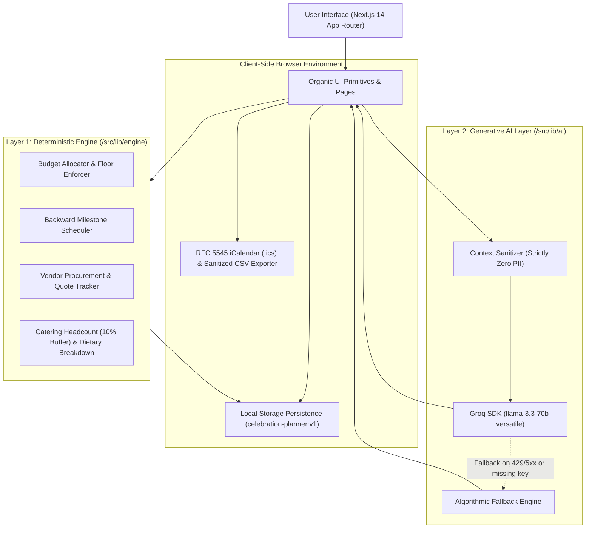

# Celebration & Event Planner

An editorial-grade celebration coordination platform and deterministic financial decision engine built with Next.js 14, TypeScript, and the Organic Design System.

The platform provides end-to-end event planning across weddings, milestone birthdays, and community festivals. It couples pure mathematical allocation algorithms with optional, privacy-isolated generative AI guidance to produce audit-ready budgets, backward-scheduled milestone timelines, vendor procurement trackers, catering headcount formulas, and printable broadsheet summaries.

---

## Architectural Philosophy

The application employs a strict two-layer architecture separating mathematical certainty from creative generation:



### Layer 1: Deterministic Calculation Engine (`/src/lib/engine`)
Pure, reproducible mathematical and algorithmic logic with zero side effects and zero external network calls:
- **Budget Allocation**: Computes exact percentage allocations based on event format, city tier, venue environment, and user priorities. Enforces non-negotiable catering viability floors (e.g., ₹500/guest for weddings, ₹250/guest for birthdays, ₹150/guest for community gatherings).
- **Proportional Rebalancing**: Dynamically adjusts discretionary categories (decor, entertainment, contingency) when user modifies actual spending lines or adjusts catering commitments.
- **Backward Milestone Scheduling**: Calculates milestone deadlines backward from the celebration date, automatically compressing schedules and staggering overdue tasks across consecutive days for short-notice events.
- **Vendor Procurement Logic**: Matches budget lines with vendor categories, flags next-to-book contracts based on milestone urgency, and offers one-click quote-to-actual budget synchronization.
- **Catering Buffer Math**: Computes suggested catering counts using the industry standard `confirmed + 10% buffer` (rounded up) with complete dietary breakdowns.
- **Calendar & CSV Generators**: Produces standard RFC 5545 `.ics` calendar files and formula-injection-sanitized CSV exports directly in the client.

### Layer 2: Generative AI Layer (`/src/lib/ai`)
Grounded contextual inspiration and conversational planning assistance powered by Groq (`llama-3.3-70b-versatile`):
- **Structured Ideation (`/api/ideas`)**: Generates structured thematic, culinary, decor, and activity concepts adhering to strict Zod JSON schemas.
- **Planning Concierge (`/api/assistant`)**: Answers logistical questions, evaluates trade-offs, and provides actionable contingencies.
- **Zero-Telemetry Fallback**: If the API key is omitted or the service encounters rate limits, a rule-based engine transparently supplies high-fidelity deterministic responses.

---

## Core Capabilities

### Context-Sensitive Generation
- **Event Type Profiles**: Weddings prioritize venue contracts, guest hospitality, and photography; birthdays anchor dining, entertainment, and custom confectionery; community festivals emphasize municipal permits, crowd safety, volunteer rosters, and staging.
- **City Tier Adjustments**: Metro areas increase venue and logistics allocations; Tier 2 cities and towns allocate greater shares to hospitality and catering.
- **Venue Environment Rules**: Outdoor celebrations enforce a mandatory weather contingency reserve (≥ 4%) and infrastructure line items; indoor venues concentrate funds on audiovisual and hall styling.
- **Priority Multipliers**: User-selected focal points (such as Food & Beverage or Photography) dynamically rebalance category weights by predefined point bonuses.

### Privacy-Preserving Architecture
- **Browser-Only Storage**: All briefs, guest rosters, financial figures, and vendor agreements remain in the client's `localStorage` (`celebration-planner:v1`).
- **PII Isolation**: Guest names, phone numbers, and personal details are strictly isolated in the browser and never transmitted to AI endpoints. AI requests receive only anonymized, aggregate event statistics.
- **CSV Formula Injection Shield**: All exported CSV cells prefixed with `=`, `+`, `-`, or `@` are sanitized with leading apostrophes to protect spreadsheet users.
- **Strict Content Security**: Configured with restrictive CSP headers, `X-Frame-Options: DENY`, `X-Content-Type-Options: nosniff`, and `Permissions-Policy`.

---

## Application Route Map

| Route | View | Description |
|---|---|---|
| `/` | Home Editorial Spread | Architectural overview, feature cards, process steps, and planning entry points. |
| `/plan` | Planning Wizard | Four-step accessible form (*The Basics*, *Scale and Place*, *Money*, *Preferences*) with live per-guest calculations and catering floor validations. |
| `/events` | Celebrations Directory | Complete repository of saved events, distinguishing upcoming from past celebrations, with confirmation safeguards. |
| `/events/[id]` | Event Overview | Newspaper-style front-page briefing, executive factual statistics strip, and urgent next-action callouts. |
| `/events/[id]/budget` | Budget Ledger | Planned targets vs. actual expenses, live variance tracking, over-budget warnings, and proportional rebalancing. |
| `/events/[id]/timeline` | Milestone Roadmap | Chronologically sequenced tasks (*Overdue*, *This Week*, *This Month*, *Later*, *Done*), critical path flags, custom milestone creation, and algorithmic regeneration. |
| `/events/[id]/vendors` | Vendor Procurement | Directory of service providers, quote-to-budget comparison, "Next to book" indicators, one-click quote-to-actual adoption, and FAQ disclosures. |
| `/events/[id]/guests` | Guest Directory & RSVPs | Individual and bulk attendee ingestion (deduplicated), dietary breakdowns, 10% catering buffer computation, and CSV export. |
| `/events/[id]/ideas` | Creative Concepts Desk | AI-assisted concept generation with provenance badges (*AI* vs. *Fallback*) and pinned idea scrapbook. |
| `/events/[id]/assistant` | Planning Assistant | Contextual conversational concierge with pre-formulated prompts, structured replies, and retry states. |
| `/events/[id]/summary` | Consolidated Broadsheet | Complete printable event briefing compiling financial tables, milestones, vendors, and dietary rosters. Includes `.ics` export, JSON backup/restore, and reset utilities. |

---

## Design System: Organic

The user interface implements the **Organic Design System**, modeling a shared worktable of sand-colored paper, irregular shapes, dark brown type, moss, and fired clay:

- **Palette**:
  - Sand Ground: `#eee6d6` (tactile page surface with faint paper grain texture)
  - Paper Surface: `#f5eddf` (raised content sheets, cards, trays, and modal sheets)
  - Dark Brown Ink: `#29251d` (primary reading type, achieving a 12.3:1 contrast ratio against ground and 13.1:1 on paper)
  - Muted Ink: `#443b2f` (secondary labels, achieving an 8.85:1 contrast ratio)
  - Moss: `#35422d` (primary actions, active navigation indicators, and process containers)
  - Fired Clay: `#694737` (budget alerts, critical deadlines, and prominent top rules)
  - Terracotta: `#ad7d62` (section markers and milestone badges)
  - Stone: `#ddd5c3` (footer surface, subtle dividing rules, and table header rows)
  - Dried Grass: `#b9b28b` (table outlines and secondary chips)
- **Typography**:
  - Headings & Display: **Source Serif 4** (`"Organic Source Serif"`, Georgia, serif) with tight tracking and compact line spacing.
  - Reading & Form Controls: **Instrument Sans** (`"Organic Instrument Sans"`, sans-serif) with generous line heights (`1.8`) for readable editorial prose.
- **Organic Geometry**:
  - Authoritative Control Radius: `27px 19px 29px 16px / 22px 26px 19px 29px`
  - Asymmetrical Tray Radius: `24px 14px 28px 18px / 18px 26px 16px 24px`
  - Paper Sheet Radius: `20px 28px 18px 26px / 26px 18px 28px 20px`
- **Accessibility & Motion**:
  - Fully compliant with **WCAG 2.1 AA** (zero automated `axe-core` violations across all pages).
  - Explicit high-contrast focus rings (`outline-offset: 3px`).
  - Native `prefers-reduced-motion` support eliminating all transitions and transforms for users requesting reduced motion.

---

## Tech Stack

- **Framework**: Next.js 14 (App Router, React Server Components, Route Handlers)
- **Language**: TypeScript 5 (Strict Mode enabled)
- **Styling**: Pure CSS with Authoritative Custom Properties (no Tailwind CSS, no utility CSS runtime)
- **Validation**: Zod (Schema validation for forms, storage boundaries, and API payloads)
- **AI Integration**: Groq SDK (`llama-3.3-70b-versatile`)
- **Testing**: Vitest, React Testing Library, `jest-axe`, JSDOM
- **Code Quality**: ESLint, Prettier

---

## Getting Started

### Prerequisites
- Node.js 18.17 or higher
- npm 9.0 or higher

### Installation

1. Clone the repository:
   ```bash
   git clone https://github.com/meetchauhan17/Celebration-Planner.git
   cd Celebration-Planner
   ```

2. Install dependencies:
   ```bash
   npm install
   ```

3. Configure environment variables (optional):
   ```bash
   cp .env.example .env.local
   ```
   Add your Groq API key in `.env.local`:
   ```env
   GROQ_API_KEY=gsk_your_groq_api_key_here
   ```
   *Note: If omitted, the application operates fully offline using high-quality deterministic fallback engines.*

4. Launch the local development server:
   ```bash
   npm run dev
   ```
   Open **http://localhost:3000** in your browser.

---

## Scripts & Verification

| Command | Purpose |
|---|---|
| `npm run dev` | Starts the Next.js development server with hot module replacement on `http://localhost:3000`. |
| `npm run build` | Compiles an optimized production build and generates static/dynamic routes. |
| `npm run start` | Serves the production build locally. |
| `npm test` | Runs the full Vitest test suite (243 unit, engine, domain, and accessibility tests). |
| `npm run typecheck` | Executes TypeScript type checking (`tsc --noEmit`). |
| `npm run lint` | Runs Next.js ESLint verification. |

---

## Test Suite Summary

The repository includes comprehensive automated test coverage spanning 30 test suites (243 passing tests):

- **Pure Calculation Engines (`/tests/engine`)**: Unit tests for budget math, catering floors, short-notice compression, vendor priorities, and RFC 5545 iCalendar serialization.
- **Domain Models & Schemas (`/tests/domain`)**: Boundary, typing, and validation tests for event briefs, guest entities, and timeline tasks.
- **Security & Privacy (`/tests/ai/security.test.ts`)**: Verification of zero PII leakage in AI payloads, CSV injection sanitization, and rate-limiting enforcement.
- **Accessibility (`/tests/**/axe`)**: Automated `axe-core` accessibility audits across every view and modal dialog confirming zero violations.
- **Design System & Contrast (`/tests/design-system`)**: Authoritative token validation, WCAG AA/AAA contrast math checks, and responsive CSS breakpoint assertions.

---

## Limitations & Advisory

- **Planning Guidance Only**: This software provides structured organizational schedules and financial baselines. It does not provide legal, accounting, or professional event production advice.
- **Vendor & Permit Verification**: Always verify formal pricing, contractual terms, municipal fire/noise permits, and cancellation policies with certified vendors and local authorities.

---

## License

This project is licensed under the MIT License.
